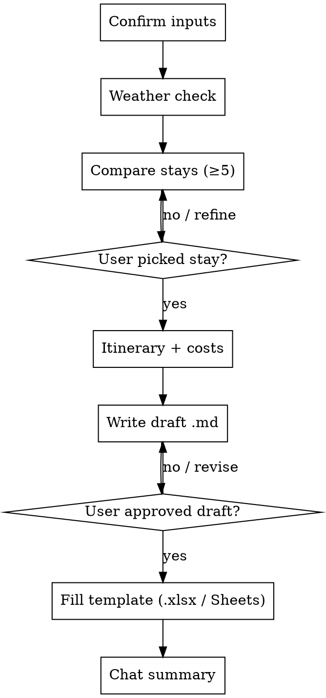

# Travel Planner

Turn a vague trip idea into a **complete plan you can book from**: confirmed requirements, weather check, compared stays, a chosen option, hour-by-hour itinerary, cost estimate, a **markdown draft the user reviews** (`docs/<destination>-trip-planning.md`), and, once they approve it, a **workbook filled from the bundled template** (`assets/trip-template.xlsx`), delivered as Excel `.xlsx` or Google Sheets.

The problem this solves is half-plans — a list of hotels with no itinerary, or a packed schedule with no budget reality. The deliverable is a reviewed draft, then one spreadsheet plus a short chat summary the group can act on.

## When NOT to use this skill

- Visa, immigration, or travel insurance only
- Book one flight or one hotel with no broader plan
- One-off restaurant or café recommendation
- User already booked everything and only wants packing tips (answer inline; no full workflow)

For open-ended "where should I go?" research without dates or budget, prefer `research`. Come back here once they have (or are ready to confirm) dates, headcount, and budget.

<HARD-GATE>
Do NOT build the detailed itinerary, finalize the budget, or export the workbook until:

1. **Required inputs are confirmed** — dates, budget per person, number of people, and either a destination or a shortlist the user agrees to compare.
2. **The user has picked one stay** (Step 4) — name it explicitly in chat before Step 5.

Do NOT create the workbook until **the user has approved the draft** (Step 8): no `.xlsx` and no Google Sheet before that, not as a preview and not in a temporary or scratch folder. Asking for an Excel or Google Sheets file in the first message names the format; it is not approval of a draft the user has not seen yet.

If the user is still browsing options or has not confirmed dates/budget, stop after Step 3 or 4. If the draft is not approved yet, stop after Step 8.
</HARD-GATE>

## Checklist

Complete in order. Do not skip ahead past a gate.

1. **Confirm trip inputs** — destination or shortlist, dates, budget/person, headcount, group type, travel style, transport mode, dietary needs if relevant
2. **Weather & season** — web search; warn and offer backup if bad
3. **Search & compare stays** — at least 5 options (or 3 with documented search failure); read the right reference file first
4. **User selects one stay** — HARD-GATE; stop if not confirmed
5. **Build itinerary** — departure through return, with rain backup
6. **Cost estimate** — categories + 10–15% buffer; flag if over budget
7. **Write the draft** - `docs/<destination>-trip-planning.md`, everything the workbook will contain (see `references/draft-template.md`)
8. **User reviews the draft** - HARD-GATE; revise the file until they approve it
9. **Export workbook** - fill a copy of `assets/trip-template.xlsx` from the approved draft; deliver as `.xlsx` or Google Sheets (see `references/export-by-runtime.md`)
10. **Summarize in chat** - highlights, cost/person, warnings, preparation list, link to Sheets or `.xlsx`

## Process flow



## Reference files — read before searching

| Trip type | Read first |
|-----------|------------|
| Vietnam domestic | `references/domestic-vn.md` |
| Outside Vietnam | `references/international.md` |
| Draft for review (Step 7) | `references/draft-template.md` |
| Workbook cells & plan data | `references/output-schema.md` |
| Export as `.xlsx` or Google Sheets | `references/export-by-runtime.md` |

Do not load both domestic and international references unless the user is genuinely comparing cross-border options.

---

## Step 1: Confirm trip inputs

Gather what is missing **one topic at a time** when the user's first message is incomplete. Priority order:

1. **Destination** — specific place, region, or "no idea yet" (then suggest 3–5 fits from budget/style/dates)
2. **Dates** — leave/return as full dates, number of nights
3. **Budget per person** — accommodation only vs all-inclusive trip budget
4. **Travel style** — resort, onsen, villa, homestay, glamping, nature, city…
5. **Headcount & group** — couples, family with kids, friends, team building
6. **Transport** — departure point, then self-drive, bus/train, flight, hire car (affects cost and itinerary)
7. **Dietary restrictions** — if you will suggest restaurants

If the first message already has enough to proceed, summarize back for confirmation and continue.

**Required before Step 2:** dates, budget/person, `num_people`, and destination or agreed shortlist.

---

## Step 2: Weather & season

Use **WebSearch** for `"weather [destination] [month/year]"` or the specific dates.

Include: typical conditions, rain/storm risk, peak season pricing, anything that changes outdoor plans.

If weather is poor, say so and offer: different dates, backup destination, or indoor/rain Plan B before lodging search.

---

## Step 3: Search & compare stays

Use **WebSearch** and **WebFetch** on booking pages when useful. Follow the platform list in the reference file for the trip region.

**Output:** at least **5** options (3 minimum only if you document exhausted search — widen budget ±20% or area first).

For each option use this table (see `references/output-schema.md` for column rules):

| Field | Content |
|-------|---------|
| Name & type | Resort / villa / homestay / … |
| Price/night | Amount + currency + source + "reference price as of [date]" |
| Rating | Score + review count |
| Distance | From user's departure city/point |
| Pros | 3–4 bullets |
| Cons | 2–3 bullets |
| Booking link | URL |
| Best for | Couples / family / friends / … |

Cross-check price on more than one platform when possible. Cross-check reviews (Maps + booking site).

---

## Step 4: User picks one stay

Present a comparison summary and ask which option to plan around.

If unhappy: search more, adjust budget, area, or style — then re-present. **Do not continue until one stay is named.**

---

## Step 5: Itinerary

Cover **departure through return** in time blocks:

- Morning (06:00–11:00)
- Midday (11:00–14:00)
- Afternoon (14:00–18:00)
- Evening (18:00–22:00)

Include: restaurants with rough prices, activities matching style, transit time between stops, rain backup.

Give every slot the transport used to reach it and the fare per person for that leg (blank when free), plus a status when something must be booked ahead (`Mua vé trước`). These become the `Phương tiện`, `Giá` and `Trạng thái` columns of the `Itinerary` sheet.

Keep density reasonable — families, seniors, and young kids need slack.

---

## Step 6: Cost estimate

Categories:

1. **Lodging** — nightly rate × nights (note shared vs per-room split)
2. **Transport** — fuel, tolls, grab/taxi, parking, flights, trains
3. **Food** — ~3 meals/day × people × days (adjust for style)
4. **Activities** — tickets, spa, rentals
5. **Buffer** — 10–15% contingency

If total per person exceeds budget by >30%, warn clearly and offer cuts (cheaper stay vs fewer activities).

Build two lists for `references/output-schema.md`:

- `costs` - the estimate, one line per item with a **price per person** and its currency. Each line becomes a row with a tick box on the `Checklist` sheet; mark it done only when the user said it is already booked or paid. Divide shared costs (room, hire car, private transfer) by the headcount. Each transport cost goes in one place: local legs paid on the spot (bus, metro, taxi) are the per-leg fares from Step 5, which the workbook sums itself; tickets booked ahead (flights, long-distance trains, hire car) are `costs` lines.
- `expenses` - the items booked or paid before the trip (stay, flights, visa, eSIM, tickets bought ahead) with their **total** price. They seed the spending log.

For a trip abroad, look up the exchange rate to the home currency and note the date you read it.

---

## Step 7: Write the draft

**Read `references/draft-template.md` and `references/output-schema.md` first.** Write the whole plan to `docs/<destination>-trip-planning.md` (for example `docs/hong-kong-trip-planning.md`): every value that will go into the workbook, in the template's sections. A markdown file is quick to read and cheap to change, so the user settles the plan here and the spreadsheet is built once.

Do not create a spreadsheet in this step.

---

## Step 8: User reviews the draft

Give the path of the draft, the cost per person against the budget, and ask the user to review the itinerary and say whether it is final. If they have not named a format, ask in the same message whether they want Google Sheets or Excel.

- Changes requested: update the same file (rerun the earlier step when the change needs new research or new prices), then ask again.
- Approved ("chốt", "ok", "xuất file đi"), said in reply to this question after the draft path was shown: continue to Step 9.

**Do not continue until the user approves the draft.**

---

## Step 9: Export workbook (.xlsx or Google Sheets)

**Read `references/export-by-runtime.md` and `references/output-schema.md` first.** Fill the workbook from the approved draft, value for value. The skill supports both formats, and both are a filled copy of the same template, `assets/trip-template.xlsx`, so the user gets the same workbook either way.

1. **Pick the format** - the one the user named (Excel, `.xlsx`, Google Sheets, ggsheet). If they named none: Google Sheets when a Sheets or Drive tool is connected, otherwise `.xlsx`.
2. **Assemble plan data** from the approved draft, in the shape of `references/output-schema.md`.
3. **Fill a copy of the template** - write values only into the cells the schema lists. The template already carries the layout, formulas, dropdowns and colours; rebuilding the workbook from scratch or typing over a formula cell loses them.
4. **Deliver** - the `.xlsx` saved next to the draft as `docs/<destination>-trip.xlsx` (not in a temporary, scratch or sandbox output folder), or the Google Sheets link (upload the filled file with conversion, or build the same three tabs natively when the tool cannot upload).
5. **Verify** with the list at the end of the export reference; fix and re-check before Step 10.

The workbook has exactly three sheets: `Itinerary` (plan, currency and headcount settings), `Checklist` (cost estimate with one tick box per line, plus the `Thông tin chung` table of trip facts and totals) and `Summary` (spending log). Keep all three, with those names. Fill `Thông tin chung` with the values of the approved draft, following its rules in the schema.

Never hand-type a loose markdown table as the final deliverable when a spreadsheet tool is available.

**Output language:** sheet names, column headers and the chat summary labels stay Vietnamese, exactly as written in the template and in Step 10; free-text content follows the language the user writes in.

---

## Step 10: Chat summary

```markdown
## [Destination] - [dates]

**Chỗ nghỉ:** [name] - [link]
**Chi phí dự kiến:** [X]/người (đã gồm buffer [%])
**Thời tiết:** [one line]

### Highlights
- [day 1 highlight]
- [day 2 highlight]

### Lưu ý
- [booking deadline, cancellation, price disclaimer, exchange rate and its date]

### Chuẩn bị
- Đồ cần mang: [packing]
- Việc trước chuyến đi: [pre-trip tasks]
- Liên hệ khẩn cấp: [contacts]

Tệp: [Google Sheets link] hoặc `docs/<destination>-trip.xlsx`
```

Ask if they want changes. A change after export goes into the draft first, then into the workbook. Before replacing an exported file or sheet, ask: the user may already have logged spending in `Summary`, so either edit the affected cells in the existing workbook or get their go-ahead to rebuild it.

---

## Example

**User:** "6 người đi Tam Đảo thứ 7-CN, budget 2 triệu/người, muốn villa có bể bơi"

**After Step 3 (abbreviated):**

| | Villa A | Villa B |
|--|---------|---------|
| Giá/đêm | 3.2M (Agoda) | 2.8M (Airbnb) |
| Rating | 4.6 (89) | 4.4 (210) |
| Phù hợp | Nhóm lớn, bể riêng | Gần trung tâm, giá tốt |

**After Step 7:** `docs/tam-dao-trip-planning.md`, then the question: review the itinerary, final or changes, Google Sheets or Excel?

**After Step 10 (the user approved):** summary block + the filled template: `docs/tam-dao-trip.xlsx`, or a Google Sheets link if the user asked for one.

---

## Lessons learned

- Same room can differ 20-30% across platforms, so cross-check prices and never trust a single review source.
- Transport (tolls, fuel, grab) is often 10-20% of budget.
- Prefer free-cancellation stays when dates are uncertain.
- Skip nothing on transport mode: it changes both cost and timeline.

| Issue | Response |
|-------|----------|
| Stale or missing prices | State "giá tham khảo tại [ngày]" + booking link |
| Sold out weekends | Book early or shift to weekdays |
| Closed or renamed property | Check review dates; verify on Maps |
| Google Sheets asked for, no Sheets or Drive tool | Deliver the `.xlsx` and tell the user to open it with Google Sheets |
| No spreadsheet or code tool at all | Say so; offer the markdown summary as interim |

Ask the user when: budget is too low for the requirements (what to cut), two options tie (which priority), weather is bad (change dates or keep with an indoor plan), or the group is special (infant, pet, accessibility).
